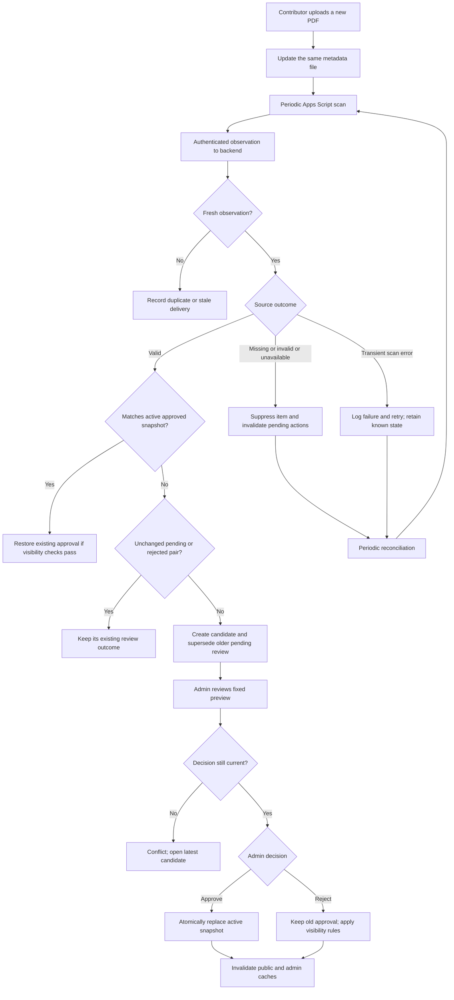

# Archive: Functional and Technical Specification

**Project:** BEM ITS / KM ITS website

**Date:** 2026-10-29

**Status:** Agreed functional behavior with a proposed implementation baseline

**Audience:** Backend, frontend, QA, document managers, and future cabinet maintainers

## 1. Purpose and authority

Archive lists ministry documents on the BEM ITS website and opens their PDF files from Google Drive. Contributors submit and replace documents through Drive. Administrators review the detected PDF and metadata before publication.

This specification records the latest agreed behavior. Technical structures, field names, routes, and configuration defaults below are an implementation proposal, not evidence that any integration has been configured or built.

The existing local reference documents are `BM_ITS_Backend_Architecture_Review.md`, `BM_ITS_Flow_3_Archive.mmd`, and `BM_ITS_System_Flowcharts.mmd`. They describe a Next.js modular monolith on a VPS, MongoDB, Apps Script ingestion, and Drive-hosted PDFs. Their Archive flow still uses Form/Sheet metadata submission and leaves Archive approval undecided. This specification replaces those Archive-specific assumptions: direct Drive submission, one mutable metadata file per logical document, and mandatory approval are the agreed behavior. Other feature domains are unchanged.

This file is self-contained; the earlier working documents may not be included in a fresh repository checkout.

## 2. Agreed decisions

| Topic | Decision |
| --- | --- |
| Feature name | Archive. Renaming is outside this specification. |
| Submission | All PDF submissions originate in Google Drive; no Google Form is required. |
| Contributors | Ministries use their own Google accounts or individually granted Drive access. |
| Replacement PDF | Every new version is uploaded as a new Drive file. Existing PDFs must not be overwritten in place. |
| Metadata | One metadata file represents one logical document and is updated in place when its PDF reference or descriptive information changes. |
| Identity | The metadata file's Drive ID is the stable source identity for the logical document. |
| Descriptive values | Names, titles, authors, and creators may change or repeat. They are not identity keys. |
| Synchronization | Apps Script checks configured Drive folders periodically and sends observations to the backend. |
| Receipt time | The backend records when it receives an observation. Drive timestamps are not the application's receipt time. |
| Review | An administrator approves a specific PDF and metadata snapshot before it can become the published version. |
| Pending replacement | A newer valid candidate replaces the older candidate in the main review queue. The old candidate remains in history. |
| Existing publication | A valid replacement awaiting review does not replace the published version. |
| Rejection | If a replacement is rejected, the previous published version remains visible, provided its source remains valid. |
| Invalid latest source | Missing metadata or an incomplete/mismatched latest submission hides the document from the website, including its older published version. |
| Recovery | Periodic synchronization checks for recovery. Recovery does not approve changed content. |
| Consistency boundary | Decisions use the latest source state already accepted by the backend, not undetected Drive changes. |
| Readers | The document-reading identity is separate from the source-management identity. Published PDFs must be readable by public visitors. |
| Public opening | The website checks the active PDF and its binding before opening it. Missing or mismatched active sources produce a website 404. |
| Publication scope | The application publishes entries on the BEM ITS website. It does not publish to other platforms. |

No publication waiting period is established by the latest agreement. There is no scheduled publication delay in this specification. An approval can make the approved version visible once the other visibility conditions are satisfied.

## 3. Terminology and invariants

| Term | Meaning |
| --- | --- |
| Document | A lasting Archive item, independent of any particular PDF. |
| Metadata source | The one mutable Drive metadata file controlling that document's submissions. |
| PDF version | A separately uploaded PDF with its own Drive file ID. |
| Observation | A source state reported by the synchronization process, including valid, invalid, missing, or unavailable states. |
| Candidate | An immutable backend snapshot of a PDF reference, content fingerprint, and normalized publication metadata, awaiting a review decision. |
| Active snapshot | The most recently approved version selected for publication. |
| Superseded candidate | A pending candidate replaced by a newer source submission. It cannot be approved. |
| Suppression | Temporary exclusion from public display because a required source condition is not satisfied. It does not erase approval history. |

The implementation must preserve these invariants:

1. One metadata source ID maps to one logical Archive record.
2. Only an explicit admin approval can select a new active snapshot.
3. Public title, description, author information, and PDF reference come from the same approved snapshot.
4. A mutable source update must never silently alter an approved or reviewed snapshot.
5. At most one current candidate is eligible for review per document.
6. A delayed observation must not overwrite a more recent accepted source state.
7. Repeated delivery of the same observation does not create duplicate candidates or approvals.
8. Source suppression does not erase the active snapshot, rejection, or manual unpublish decision.
9. A known invalid latest submission hides the entire document until source validity recovers.
10. A rejected but otherwise valid replacement does not invalidate the old approved PDF.

## 4. Actors and boundaries

| Actor or component | Responsibility |
| --- | --- |
| Ministry contributor | Upload a new PDF, update the existing metadata file, and correct source errors. |
| Source manager | Maintain source folders, contributor access, and public PDF sharing. |
| Reader identity | Read the configured metadata and PDF sources without editing them. |
| Apps Script | Discover sources, read observations, authenticate ingestion requests, and retry failed deliveries. |
| Next.js backend | Validate source authority and payloads, enforce ordering and review decisions, maintain public visibility, and check public document openings. |
| MongoDB | Store document identity, source state, immutable review snapshots, decisions, and synchronization history. |
| ADMIN / SUPER_ADMIN | Review, approve, reject, inspect failures, and use the project's publication controls. |
| Public visitor | Read visible Archive entries and open their approved PDFs. |

Apps Script must not decide approval, roles, or website publication. A contributor's knowledge of a metadata ID is not authorization to modify another ministry's Archive record.

The backend must map each configured source folder to its ministry. A metadata field or request body must not be allowed to override that authority.

## 5. Source organization and identity

### 5.1 Folder layout

The proposed source layout is:

```text
Archive root/
  Ministry A/
    annual-report.md       # Edited in place throughout this document's life
    annual-report-a.pdf    # Previously submitted PDF
    annual-report-b.pdf    # New separately uploaded PDF
  Ministry B/
    policy.md
    policy-a.pdf
```

Names are organizational conveniences. The metadata's `driveFileId` is the association with a PDF. A PDF name is not a lookup key. An unreferenced PDF does not become an Archive item by itself.

The implementation must traverse configured subfolders and all result pages. A partial listing must never be treated as a complete inventory for deletion detection.

### 5.2 Identifiers

| Field | Origin and lifetime |
| --- | --- |
| `archiveId` | Backend record ID; stable website identity. |
| `externalSubmissionId` | Metadata Drive file ID; stable source identity, retaining the existing project's field name. |
| `metadataFileId` | Explicit alias for that same metadata Drive ID in ingestion contracts. It must equal `externalSubmissionId` in stored records. |
| `driveFileId` | The PDF referenced by one candidate or active snapshot; changes on PDF replacement. |
| `candidateId` | Backend-generated identifier for one review snapshot. |
| `metadataDriveVersion` | Drive's change counter for that metadata file; used for source ordering, not a human edition number. |

Drive's `version` counter is scoped to a single file. Comparing version counters from two separate PDFs does not determine their publication order. See the [Drive file reference](https://developers.google.com/workspace/drive/api/reference/rest/v3/files).

Deleting and recreating metadata gives it a different Drive ID and therefore creates a new logical document. Matching titles must not merge the records. Recover the original metadata file with its original ID where possible; identity migration or merging requires a separate explicit administrative procedure.

Renaming metadata while preserving its ID does not create a new document. Moving it within the same authorized ministry scope does not change identity. Moving it to another ministry must not silently transfer authority; flag it for source management.

## 6. Metadata contract

### 6.1 Proposed file format

The implementation baseline is UTF-8 Markdown with one YAML front matter object. The exact parser and validation library remain implementation choices. Plain TXT or another format is not automatically supported by this profile.

Example content of `annual-report.md`:

```markdown
---
schemaVersion: 1
driveFileId: "EXAMPLE_NEW_PDF_DRIVE_ID"
title: "Annual Ministry Report"
description: "Approved activities and outcomes for the reporting period."
category: "Report"
year: 2026
authors:
  - "Document Author"
---

Optional internal editing notes. These notes are not published.
```

The outer `markdown` fence is illustrative and is not part of the actual metadata file.

| Field | Proposed validation |
| --- | --- |
| `schemaVersion` | Required supported integer; initially `1`. |
| `driveFileId` | Required nonempty Drive file ID, not an arbitrary URL. |
| `title` | Required nonempty text. Duplicate titles are allowed. |
| `description` | Optional plain text, normalized to an empty value when omitted. |
| `category` | Optional plain text; category vocabulary is a configuration choice. |
| `year` | Optional integer representing the document's reporting year, not its receipt year. |
| `authors` | Optional list of nonempty display names. Names are not authentication evidence. |

The ministry comes from folder configuration. The metadata's ID, timestamps, candidate ID, review status, and publication status are not entered by contributors.

Reject duplicate YAML keys, unsupported schema versions, unsafe YAML tags, malformed structures, and unknown front matter fields under the initial schema. Configure explicit input lengths, metadata file size, PDF size, and allowed folder depth before deployment. Treat metadata text as untrusted input and escape it when rendered.

Optional Markdown notes are excluded from public output and from the review fingerprint. A formatting-only or notes-only edit does not require another approval when normalized public values and the PDF are unchanged.

### 6.2 Required steps for a replacement

1. Upload the replacement as a new PDF.
2. Obtain its Drive file ID.
3. Edit the existing metadata file and replace `driveFileId` with that new ID.
4. Update any changed title, author, category, year, or description.
5. Save the metadata without deleting or recreating its Drive file.
6. Check the admin synchronization result and correct reported errors.
7. Keep the previously approved PDF available while it remains the active version.

The contributor does not need to enter a revision number, checksum, creation date, or last-edited time. The connector reads file facts; the backend records receipt and decisions.

### 6.3 Matching and review fingerprint

A valid pair requires an allowed metadata source, valid front matter, an accessible PDF with the specified ID, the expected PDF type, and an authorized source location. Source type checks must not rely on the filename extension alone. PDF parsing or byte checks must support the chosen validation policy.

Record the PDF's provider facts separately from author-entered display metadata. Provider facts include file ID, name, creation and modification timestamps, and content checksum when available. These values are diagnostics; matching timestamps are not proof of matching content.

The proposed `reviewFingerprint` is SHA-256 over a deterministic representation of:

- Metadata file identity and authorized ministry identity.
- Referenced PDF file ID and a verified SHA-256 fingerprint of its bytes.
- Normalized public front matter values, including schema version.

A Drive checksum can be used when available and verified under the connector policy; otherwise compute the fingerprint from the downloaded PDF. If a trustworthy content fingerprint cannot be obtained, the candidate is not ready for approval. Google describes available checksum fields in the [Drive file reference](https://developers.google.com/workspace/drive/api/reference/rest/v3/files).

Drive's metadata version and timestamps are not part of the semantic fingerprint. An observation may be newer without changing what an admin is being asked to approve. Conversely, changing public metadata while keeping the same PDF creates a new review snapshot.

Read the metadata version before and after assembling a pair. Discard and retry observations assembled while the metadata changes. Check the PDF fingerprint again during approval; an in-place PDF edit is a source violation and must not reuse an existing approval.

## 7. Receipt and timing

`receivedAt` is the backend's UTC time when an ingestion request arrives. Keep it for each received observation, including duplicates and failures, in synchronization logs. Do not accept a client-provided receipt time as authoritative.

`firstReceivedAt` on a candidate records the first backend receipt that produced that candidate. Repeated delivery does not change it. `lastReceivedAt` may track later delivery attempts. Source timestamps remain separate provider facts.

A configurable five-minute polling interval is a proposed starting point, not a processing duration, deadline, or delivery guarantee. Detection, retries, validation, dashboard refresh, and cache refresh add latency.

Approval is effective when the backend commits it. The next fresh public request can use the new active snapshot; an already open browser page does not update without a refresh or client refresh mechanism.

## 8. Synchronization and ordering

### 8.1 Observation types

| Observation | Meaning |
| --- | --- |
| `VALID` | Stable, valid metadata and its referenced PDF were read successfully. |
| `INVALID` | A known source fails parsing, binding, type, location, or required-field validation. |
| `MISSING` | A known metadata source is confirmed absent from its authorized source scope. |
| `UNAVAILABLE` | A specific known file cannot be read; deletion and lost access may be indistinguishable. |
| `SYNC_ERROR` | The connector cannot establish current source state because of authentication failure, throttling, network failure, or another transient/service-wide problem. |

Known invalid, missing, or file-specific unavailable source states suppress the document. A failed scan is not proof of mass deletion. `SYNC_ERROR` preserves the last established source state and records an operational error. A public opening that cannot validate the active PDF still fails with a temporary error rather than redirecting blindly.

Source absence is established by a completed authorized inventory or a targeted lookup with enough context to identify the unavailable source. Never infer absence merely because a file was omitted from an incomplete response. Drive can return 404 for missing files or missing read access; logs must describe this ambiguity accurately. See [Drive error handling](https://developers.google.com/workspace/drive/api/guides/handle-errors).

### 8.2 Ordering contract

Use `metadataDriveVersion` to reject older observations about an existing metadata file. Do not use title, PDF timestamps, or backend arrival time to decide which source edit is newer. Serialize Drive version counters as decimal strings and compare them as integers without JavaScript floating-point precision loss.

File disappearance and PDF availability can change without a new metadata version. Therefore the proposed connector also supplies a persisted monotonic `scanSequence` from one registered logical synchronization stream. The backend keeps both the source version and the observation sequence.

The minimum ordering rules are:

1. One active logical scanner owns each source scope. Overlapping executions are serialized or skipped.
2. Each new source observation gets a new sequence; retrying that observation preserves its sequence and payload.
3. A lower or equal already-applied sequence cannot regress source health, candidates, or visibility.
4. A higher sequence with a lower metadata version is inconsistent and is rejected for reconciliation.
5. Same metadata version with changed availability is allowed when based on a fresh, stable source check.
6. A different payload under the same delivery identity is a conflict, not an overwrite.
7. Resetting a scanner counter or changing its registered stream requires a controlled backend re-registration and reconciliation. Old-stream messages must not regain authority.

This prevents a delayed `MISSING` report from hiding a restored document, or a delayed old candidate from replacing a newer one. The storage mechanism for the scanner sequence is a deployment detail; its persistence and restart behavior are mandatory acceptance conditions.

### 8.3 Processing a valid observation

- Update the latest known source state and ordering watermark.
- If its fingerprint equals the active approved snapshot, no new approval is needed; supersede any different pending candidate and restore visibility when all other conditions pass.
- If its fingerprint equals the current pending candidate, refresh source facts without resetting the candidate's receipt time or review identity.
- If it equals the latest rejected snapshot and no different public content has been submitted, preserve the rejection. Routine polling must not keep reopening the same rejected proposal.
- Otherwise create a new immutable candidate and supersede the older pending candidate.
- An older approved historical snapshot that is not the active snapshot is a new replacement proposal; it is not an automatic rollback.

A changed metadata revision or relevant availability transition must invalidate stale admin decision tokens, even when the source edit does not require a new semantic candidate. A routine poll reporting the same metadata revision, fingerprint, and source health must not invalidate a review merely because its observation sequence is newer. An explicit resubmission of identical rejected content, if needed, must be an admin action with a new review attempt and audit event; it is not implied by polling.

### 8.4 Processing an invalid or missing observation

- Set the source state and suppression reason.
- Invalidate decision tokens for the old pending observation and remove it from the actionable queue.
- Preserve its snapshot and record that the source changed; do not leave it approvable.
- Retain the active approved snapshot and audit history.
- Hide the document from public lists and prevent public opening.
- Continue periodic reconciliation so corrected sources can recover.

Whether an interrupted candidate is reused internally or a new candidate attempt is created is an implementation detail. It must receive a fresh decision token after recovery, and it must not be approved automatically.

### 8.5 Delivery and recovery

Use authenticated HTTPS JSON ingestion. Retry transient delivery failures with bounded backoff. Advance the connector's acknowledged delivery checkpoint only after the backend acknowledges processing or an explicitly handled stale/duplicate result.

Changes-feed synchronization is an optional optimization; initial discovery and full reconciliation remain required. Drive's changes feed returns current file state rather than a guaranteed copy of every intermediate edit, so the application cannot promise to review edits that occur and are replaced between scans. See [retrieving Drive changes](https://developers.google.com/workspace/drive/api/guides/manage-changes).

## 9. Review and publication state

Keep source validity, active publication, and pending review as separate dimensions.

| Dimension | Proposed values |
| --- | --- |
| Source state | `VALID`, `INVALID`, `MISSING`, `UNAVAILABLE`, `UNKNOWN` |
| Review attempt | `PENDING`, `APPROVED`, `REJECTED`, `SUPERSEDED`, `SOURCE_CHANGED` |
| Active snapshot | Approved snapshot reference or `null` |
| Manual visibility | Enabled or explicitly hidden by an authorized admin |
| Effective visibility | Derived from all applicable conditions |

An Archive item is visible only if:

```text
an active approved snapshot exists
AND manual publication is enabled
AND the latest known metadata submission is VALID
AND the active approved PDF is valid and publicly readable
```

The current metadata may legitimately point to a pending or rejected PDF while the active snapshot points to the previous approved PDF. This difference is not a reference mismatch. Validate the active PDF against its approved binding, and the current source against its own submission binding.

If `isPublished` is retained from the existing schema, treat it as a derived/materialized value of this rule. It must not be independently set to true by ingestion. Missing sources must not clear the administrator's approval or manual visibility preference.

### 9.1 Behavior table

| Latest known submission | Active snapshot | Website result |
| --- | --- | --- |
| Valid, pending first approval | None | Hidden. |
| Valid replacement pending | Approved A | Show A while B waits. |
| Valid replacement rejected | Approved A | Keep showing A; do not publish B. |
| Valid candidate approved | Approved A or none | Atomically select the approved candidate as active. |
| Incomplete or mismatched latest submission | Approved A or none | Hide the entire item, including A. |
| Metadata missing or specifically unavailable | Approved A or none | Hide the entire item. |
| Active PDF missing or content mismatch | Approved A | Hide/block A; no automatic fallback to another unapproved PDF. |
| Scanner temporarily fails | Approved A | Preserve known state; direct opening still requires a successful active-file check. |
| Any source state, manually unpublished | Any | Hidden until an admin explicitly re-enables publication. |

If A was already suppressed for an invalid source, rejecting B does not override that suppression. "Old version remains visible after rejection" always requires the source and active-file conditions to pass.

### 9.2 Recovery table

| Recovery | Result |
| --- | --- |
| Same metadata ID again references the exact active approved pair | Restore that approved version automatically if not manually hidden and its PDF is valid. |
| Metadata is repaired and references a different valid pair | That pair requires review; the existing approved A may become visible again because source validity recovered, but the changed pair does not become public. |
| Same valid rejected pair is seen again | Preserve rejection; A may remain visible if valid. |
| Metadata is recreated with a new Drive ID | A new logical document, requiring its own approval. The old record stays suppressed. |
| Active PDF becomes readable again with its approved content fingerprint | It may recover automatically if all other visibility conditions pass. |
| Manually hidden item recovers its source | Keep it hidden. |

## 10. Approval concurrency

Approval and rejection apply to a candidate's PDF content and normalized metadata snapshot, not to a document in general or an arbitrary synchronization event.

The admin preview response must provide `candidateId`, `reviewFingerprint`, and a backend `decisionToken` representing the relevant record generation. The decision request must send them back. The backend must atomically verify:

1. The caller has the required admin role.
2. The submitted candidate is still the current pending candidate.
3. Its fingerprint and decision token still match.
4. The latest source is valid and still supports that candidate.
5. The candidate PDF's content and public accessibility pass revalidation.

Drive revalidation occurs outside the database operation. If another ingestion changes the document during that check, the conditional database write must fail. The final decision and active pointer change must be one atomic publication operation. A later background history update must not be required to prevent a wrong version from becoming public.

| Race | Required outcome |
| --- | --- |
| B is accepted before approval of A commits | Reject A's approval with a stale-review conflict; show B for review. |
| Approval of A commits before B is accepted | A becomes active; B becomes the next pending candidate. |
| Two admins approve A | One effective approval; the second request returns the existing outcome or a conflict, without duplicate transitions. |
| Admin rejects A while B has replaced it | Reject the stale decision; do not reject B. |
| Source becomes invalid during review | Hide the item and invalidate the old decision token. |
| Old delivery arrives after B | Ignore/reject the stale observation; never restore A as pending. |

The UI must not silently swap preview content while an admin is reading it. Show a "New update available" notice, disable stale actions, and require opening the new preview. Server validation remains mandatory even if the UI refresh is delayed.

Polling only provides consistency relative to backend-known state. If B exists in Drive but has not yet synchronized, approval of A can still succeed. The accepted operating model permits this; a fresh pre-approval scan can reduce but cannot eliminate that external-system gap.

## 11. Public access and document opening

Public lists and detail metadata read the effective visible snapshot from MongoDB. The open-document button must use a website backend route rather than bypassing checks with a raw Drive link.

On opening an item, the backend must:

1. Resolve the stable Archive record and verify effective visibility.
2. Select its active approved snapshot, not its pending source reference.
3. Check the active PDF through the authorized read adapter.
4. Verify its identity, allowed source scope, non-trashed status, content fingerprint, and public readability.
5. Redirect to the validated Drive viewer URL only when these checks pass.

Do not require the mutable metadata's current `driveFileId` to equal the active PDF while a valid replacement is pending or rejected. Such a check would incorrectly hide the approved old version.

| Situation | Proposed public response |
| --- | --- |
| Unknown Archive ID, unpublished or suppressed item | `404 Not Found` |
| Active PDF missing, no longer readable as an item, trashed, outside its authorized scope, or mismatched | `404 Not Found`, with an internal reason and alert |
| Service-wide authentication problem, timeout, rate limit, or provider outage prevents validation | `503 Service Unavailable`; no blind redirect |
| Active PDF passes validation | Temporary redirect to its validated Drive viewer |

A specific inaccessible-file result can be treated as unavailable, but must not be logged as proven deletion. An outage or expired integration credential is an operational error, not evidence that every document disappeared.

Missing metadata is normally discovered by periodic synchronization. A direct active-PDF check can detect PDF loss sooner. Neither behavior promises instantaneous propagation of all Drive edits.

Validate cache policy on lists, details, open routes, and redirects. Approval, suppression, rejection-related visibility changes, and recovery must invalidate relevant caches. Do not cache redirects in a way that bypasses later source checks. Concurrent open requests must verify that the active record generation has not changed before issuing the redirect.

There is still a gap between checking Drive and a browser following its redirect. This architecture cannot guarantee the file remains available after the check. Enforcing the no-overwrite rule reduces content-change risk; stronger delivery guarantees would require a separate approved-file serving design.

Public PDF access and website publication are different. A public Drive URL may be opened or shared outside the website even when the entry is hidden. This system does not cross-publish documents, revoke previously shared URLs, or claim exclusive distribution. No-login PDF access must be verified; the reader identity's own access is not proof of public readability.

## 12. End-to-end workflow



```mermaid
sequenceDiagram
    participant Admin
    participant Backend
    participant Scanner
    participant DB as MongoDB
    Admin->>Backend: Open candidate A
    Backend-->>Admin: Preview A and decision token
    Scanner->>Backend: New valid candidate B
    Backend->>DB: Save B and advance review generation
    Admin->>Backend: Approve A using old token
    Backend->>DB: Conditional decision for A
    DB-->>Backend: Generation or candidate mismatch
    Backend-->>Admin: Conflict; B requires a new review
    Note over Backend,DB: If approval commits first, A is active and B waits.
```

## 13. Proposed backend data model

The permanent `archives` record owns the publication-critical state. Detailed observations and candidate history may be separate records. Physical collection layout is an implementation choice, but it must support the atomic decisions in Section 10.

| Record field | Meaning |
| --- | --- |
| `_id` | Permanent Archive record identity. |
| `source` | `google_drive_archive`. |
| `externalSubmissionId` | Unique metadata Drive ID. |
| `ministryId` | Ministry assigned by authorized source configuration. |
| `sourceState`, `suppressionReason` | Latest established source validity and reason. |
| `metadataDriveVersion` | Highest applied metadata version. |
| `streamId`, `scanSequence` | Applied observation-order watermark. |
| `generation` | Backend concurrency version for relevant source and decision changes. |
| `activeSnapshot` | Approved PDF binding, public metadata, fingerprint, and approval actor/time, or `null`. |
| `pendingCandidate` | Current review snapshot reference/summary, or `null`. |
| `manualHidden` | Explicit admin suppression; synchronization cannot clear it. |
| `isPublished` | Optional materialized effective visibility, never independent authority. |
| `lastSourceCheckedAt` | Source check time reported by the connector; distinct from receipt time. |
| `lastReceivedAt`, `createdAt`, `updatedAt` | Backend-owned timestamps. |

A candidate snapshot contains its `candidateId`, document reference, PDF binding and fingerprint, normalized metadata, review fingerprint, first receipt time, source version at observation, decision status, and decision actor/time. The snapshot is immutable; review status and attempt history may change separately.

Use a unique document index for the metadata source identity. Delivery identity must be unique within its registered stream. An identical PDF may have an identical byte checksum, but different PDF file IDs must not be silently merged. Titles and authors must not be unique indexes.

Do not store the PDF bytes in MongoDB for the initial Drive-link design. Retain snapshots and decision history sufficient to explain what was reviewed, rejected, replaced, hidden, or restored. Configure retention without deleting active or actionable review records.

## 14. Proposed API contracts

These are backend contract proposals consistent with the existing project's route concepts. Exact route names may change before implementation.

| Method and route | Purpose |
| --- | --- |
| `POST /api/internal/sync/archives` | Receive authenticated source observations. |
| `GET /api/admin/archives` | Read records, source problems, pending reviews, and publication summaries. |
| `GET /api/admin/archives/:id` | Return active and pending snapshots plus review generation. |
| `POST /api/admin/archives/:id/approve` | Conditionally approve the specified current candidate. |
| `POST /api/admin/archives/:id/reject` | Conditionally reject the specified current candidate. |
| `POST /api/admin/archives/:id/unpublish` | Apply explicit manual hiding. |
| `POST /api/admin/archives/:id/publish` | Re-enable an existing approval only if visibility checks pass; cannot approve a changed candidate. |
| `GET /archive` | Public visible list. |
| `GET /archive/:id` | Public visible item metadata. |
| `GET /archive/:id/open` | Validate the active source and redirect or return a website error. |

The ingestion envelope needs a protocol version, registered stream identity, scan sequence, metadata file ID, source version when readable, observation outcome, source-check time, diagnostics, and a stable delivery identity. Valid observations also include normalized metadata and observed PDF facts. `receivedAt`, approval fields, and role information are not trusted payload inputs.

Only fetch provider URLs derived from validated Drive IDs or verified Google API responses. Do not fetch or redirect to arbitrary contributor-supplied URLs. Authenticate admin mutations, apply the project's session and request-forgery protections, and keep internal observations and pending PDFs out of public API responses.

Return structured processing outcomes: applied, unchanged, duplicate, stale, invalid observation, or source conflict. A well-formed authenticated observation reporting an invalid document is different from a malformed API request. The former must record the source problem and suppression; simply rejecting it without state changes would leave the old item incorrectly visible.

Use `401`/`403` for integration or role failures, `400`/`422` for malformed requests, and `409` for stale/conflicting admin decisions. Approval and rejection bodies identify the candidate, fingerprint, and decision token. Include actionable diagnostics in admin responses without exposing credentials or unpublished source data publicly.

## 15. Admin interface requirements

- Separate "Published version", "Latest submission", "Review status", and "Source health" in the interface.
- Show ministry, provider facts, backend receipt time, last successful synchronization, and the selected PDF preview.
- Show metadata changes and the old/new PDF identities together.
- Show clear reasons for suppression, rejection, source changes, and superseded requests.
- Exclude superseded and invalidated candidates from actionable approvals; keep them inspectable in history.
- Warn when the preview has become stale. Never submit approval for whatever candidate happens to be current without the admin seeing it.
- Keep the rejected outcome after synchronization; do not repeatedly present the unchanged rejected pair as new.
- Distinguish "no published version" from "approved version currently hidden because source metadata is invalid".
- Read dashboard data from the backend database rather than asking the browser to enumerate Drive.

Dashboard polling or another refresh mechanism is required for an open page to discover newer backend state. Its interval is configurable and does not replace server-side concurrency checks.

## 16. Google account and integration setup

The stated BEM ITS management account is a regular Gmail account. Consumer Google accounts can use Apps Script; a paid Workspace subscription is not a prerequisite for this proposed flow. Actual account access and project configuration have not been verified by this specification.

Keep management ownership and execution identity explicit. BEM ITS may manage script access, while the separate reader creates its installable trigger. Triggers execute as their creator. Grant the reader only the Archive source folders it requires, with Viewer access and a suitable read-only API scope. See [installable triggers](https://developers.google.com/apps-script/guides/triggers/installable).

`drive.readonly` permits reading files accessible to the execution identity; it is not a folder-specific OAuth scope. Application filtering alone is not an account permission boundary. `drive.file` must not be assumed to discover every future file uploaded through the ordinary Drive interface. See [Drive authorization scopes](https://developers.google.com/workspace/drive/api/guides/api-specific-auth).

Before enabling the integration:

1. Verify Apps Script access for the intended execution account.
2. Enable Advanced Drive Service for the script. With an Apps Script default Cloud project, its corresponding API is enabled automatically; with a standard Cloud project, enable Drive API explicitly.
3. Grant the minimum required read and outbound-request authorization.
4. Configure allowed roots, ministry mappings, and the registered scanner stream.
5. Configure authenticated HTTPS ingestion and safely stored secrets.
6. Give the backend read adapter its own authorized access to the same permitted source scope for approval and public-open checks. Do not assume an Apps Script authorization automatically authorizes the VPS.
7. Verify published PDF access with no Google login.
8. Configure polling, timeouts, file limits, diagnostics, and alerts.
9. Run the acceptance scenarios before allowing public publication.

See [advanced service setup](https://developers.google.com/apps-script/guides/services/advanced). The precise backend read-adapter authentication method and operational verification of public access must be selected before deployment. Public visitors must never receive OAuth tokens, integration credentials, or a privileged reader session.

Current documented consumer limits include six minutes per execution, 90 minutes of total trigger runtime per day, and 20,000 URL Fetch calls per day. A five-minute schedule has 288 runs per day, so a full scan averaging 30 seconds would already exceed the trigger budget. Keep scans bounded, use checkpoints, and measure actual workloads. Limits can change; verify them again before deployment using [Apps Script quotas](https://developers.google.com/apps-script/guides/services/quotas).

Apps Script has no native installable trigger for a PDF upload in a Drive folder. Periodic scanning is the agreed baseline. A timed trigger does not guarantee instantaneous or precisely timed detection. Direct Drive API synchronization from a backend worker can be considered later if workload, recovery, or observability outgrows this baseline; it must preserve the same review rules.

## 17. Logging, monitoring, and handover

Log the document ID, metadata ID/version, stream and sequence, delivery identity, candidate ID/fingerprint, outcome, suppression reason, receipt/check timestamps, and errors. Log approve/reject/unpublish/restore actions with actors and before/after publication identity. Never log access tokens or secrets.

Monitor last successful scan, last acknowledged delivery, repeated file-specific failures, scan backlog, incomplete inventories, source conflicts, quota failures, stale admin decisions, and public-open validation errors. A synchronization failure must be distinguishable from admin rejection or a hidden document.

The next cabinet must receive:

- This specification and a contributor guide for updating the same metadata file.
- Source root IDs, ministry mappings, ownership/access inventory, and the reader identity.
- Script project and Cloud project identifiers, trigger creator, schedule, and registration/counter recovery instructions.
- Website deployment, database, read-adapter, and integration configuration locations.
- Secure access to account recovery, required authentication, and secret storage; no credentials in this document or Git.
- Instructions for fixing invalid metadata, restoring deleted sources, retrying deliveries, and rebuilding a full inventory.
- Instructions for approval conflicts, rejection, manual unpublishing, automatic source recovery, and controlled identity migration.
- Checks that old PDFs remain available until a replacement becomes active, and that deleting metadata intentionally hides the whole website item.

If execution identity changes, recreate triggers and authorize the new identity. Preserve source identities and register any scanner stream change deliberately. A credential or counter reset is not permission to replay older source state over current publication decisions.

## 18. Acceptance scenarios

| ID | Scenario | Required result |
| --- | --- | --- |
| A01 | New valid metadata/PDF pair | One document and pending candidate; no public entry. |
| A02 | Admin approves the current candidate | Its PDF and metadata become active together. |
| A03 | Same title or author on different metadata IDs | Separate logical records. |
| A04 | Metadata renamed without an ID change | Same logical document. |
| A05 | Same metadata points to a new valid PDF | New candidate; old approved version remains visible. |
| A06 | Latest valid replacement rejected | Old approved version remains visible if sources pass. |
| A07 | Same rejected pair appears in later polls | Rejection persists; no repeated pending request. |
| A08 | Latest metadata has a bad/missing PDF reference | Whole document hidden; previous approval retained. |
| A09 | Existing metadata disappears | Whole document hidden after confirmed observation. |
| A10 | Missing metadata restored to active approved pair | Same approved version can recover automatically. |
| A11 | Missing metadata repaired to changed valid pair | Changed pair requires review; approved old version may recover separately. |
| A12 | Metadata deleted and recreated with the same name | New ID creates a new document; no implicit merge. |
| A13 | B reaches backend before approval of A commits | Stale approval rejected; B remains pending. |
| A14 | Approval of A commits before B reaches backend | A active; B pending. |
| A15 | B exists in Drive but has not synchronized | Backend may still approve its latest known A; limitation is visible in sync status. |
| A16 | Delayed delivery of A arrives after B | A does not replace B or regress source state. |
| A17 | Old missing-source report arrives after restoration | Old report ignored by ordering rules. |
| A18 | Duplicate delivery or repeated admin request | No duplicate candidate or publication transition. |
| A19 | Same sequence arrives with different data | Conflict logged; no overwrite. |
| A20 | PDF/metadata changes while snapshot is assembled | No mixed snapshot; retry stable read. |
| A21 | Public metadata changes on the same PDF | New candidate and new review fingerprint. |
| A22 | Notes-only metadata edit | No new semantic approval, but source watermark is updated. |
| A23 | Active PDF overwritten despite source policy | Fingerprint mismatch; block opening and alert. |
| A24 | Active PDF is removed or specifically inaccessible | Website 404; retain record and diagnose unavailable source. |
| A25 | Drive timeout, rate limit, or global auth failure | No mass-deletion inference; opening returns temporary failure when validation is impossible. |
| A26 | Folder inventory fails partway through pagination | No disappearance decisions from the incomplete inventory. |
| A27 | Valid source returns after manual unpublish | Remains manually hidden. |
| A28 | PDF is readable by the integration but not anonymously | It cannot pass the public-readability publication gate. |
| A29 | Raw title, author, or ministry claim attempts identity takeover | Folder authority and identity checks prevent cross-document/ministry replacement. |
| A30 | Suppression, approval, or recovery occurs with cached pages | Fresh public requests and open routes reflect backend state without a stale cached redirect bypass. |
| A31 | Metadata current target is rejected B while active target is A | A is not rejected as a mismatch merely because current metadata references B. |
| A32 | Previously approved historical pair is proposed again | Review required unless it is the currently active approved snapshot. |
| A33 | Scanner restarts or execution account changes | Registered order remains valid or controlled re-registration occurs; old messages cannot regress state. |
| A34 | Routine poll reports the exact same source revision and health | Review remains actionable; only observation/diagnostic watermarks advance. |

## 19. Remaining implementation choices

These choices do not reopen the agreed product behavior, but must be recorded before deployment:

- Real source roots, ministry IDs, access grants, and account/project identifiers.
- Final metadata parser, field limits, PDF validation, checksum policy, and public-access verification method.
- Actual polling/dashboard intervals and workload measurements; five minutes remains a starting estimate.
- Backend Drive read-adapter authentication and secret management.
- Scanner sequence persistence, full-inventory completion protocol, and stream re-registration procedure.
- Database physical layout, conditional-write implementation, and history retention.
- Final route names, cache strategy, operational alerts, and recovery tools.
- Whether any deliberate resubmission, rollback, or identity-migration tools are needed beyond the core flow.

No code, Apps Script deployment, Drive permission update, or website implementation is performed by creating this specification.

## 20. Technical references

Official documentation reviewed on 2026-10-29:

- [Drive files: fields, change counters, and checksums](https://developers.google.com/workspace/drive/api/reference/rest/v3/files)
- [Drive change retrieval](https://developers.google.com/workspace/drive/api/guides/manage-changes)
- [Drive file and folder search](https://developers.google.com/workspace/drive/api/guides/search-files)
- [Drive API errors](https://developers.google.com/workspace/drive/api/guides/handle-errors)
- [Drive API authorization scopes](https://developers.google.com/workspace/drive/api/guides/api-specific-auth)
- [Apps Script automation prerequisites](https://developers.google.com/apps-script/quickstart/automation)
- [Apps Script installable triggers and execution identity](https://developers.google.com/apps-script/guides/triggers/installable)
- [Apps Script advanced service configuration](https://developers.google.com/apps-script/guides/services/advanced)
- [Apps Script service quotas](https://developers.google.com/apps-script/guides/services/quotas)
